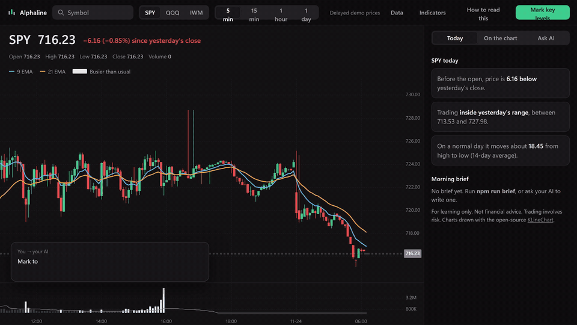
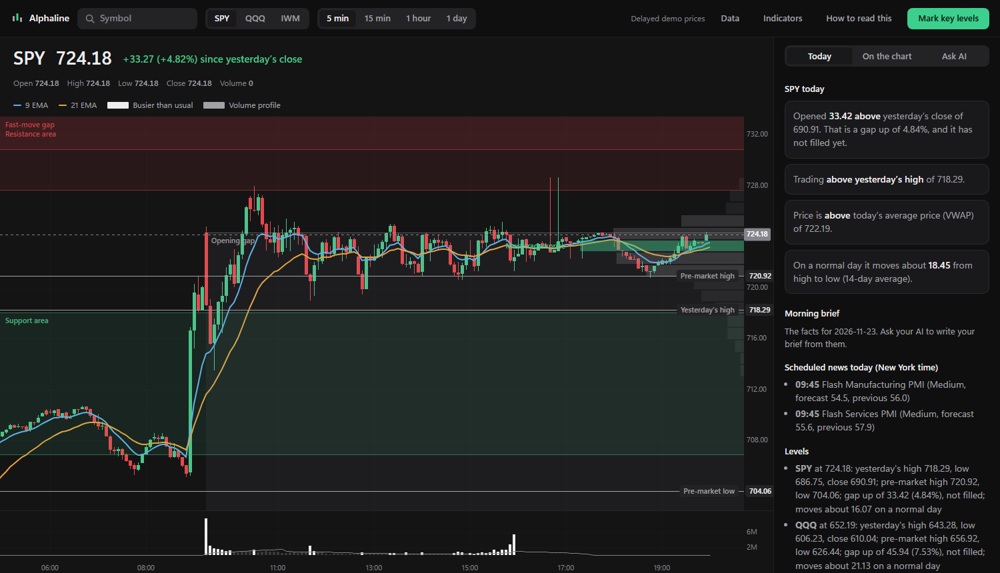
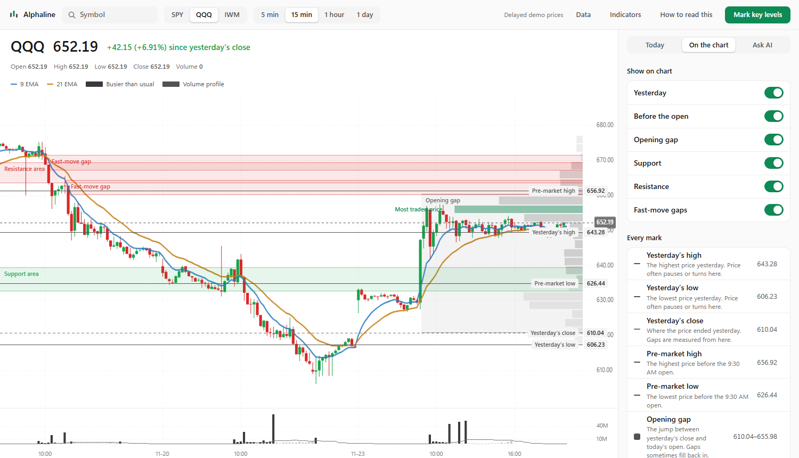
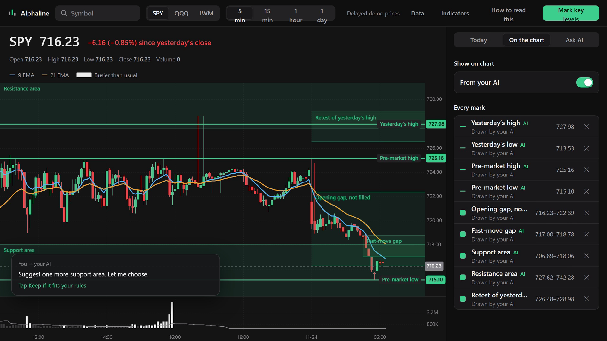

# Alphaline

**Free trading charts that run on your own computer, and that your own AI draws on.**

Bring the Claude or Codex subscription you already have. Ask it to "mark today's key levels using my rules" and watch the lines appear. No account, no drawing limits, no monthly fee. Your charts, drawings and notes stay in one folder on your machine.

Made by [Alpha Trading Pros](https://alphatradingpros.com). For learning only, not financial advice. Trading involves risk.



| Dark | Light |
|---|---|
|  |  |



*Screenshots use delayed demo prices.*

## What you get out of the box
- Clean candlestick charts in 5 minute, 15 minute, 1 hour and 1 day candles, light and dark
- The 9 and 21 EMA, plus volume bars that turn white when trading is busier than usual
- **Mark key levels** in one click: yesterday's high, low and close, the pre-market high and low, the opening gap, nearby support and resistance areas, and fast-move gaps (fair value gaps)
- Every mark has a plain-English name and a one-line explanation, written for people new to trading
- A **Today** panel that describes the day in plain sentences (facts, never forecasts) and a morning brief with the day's scheduled US economic news
- Volume profile, VWAP, Bollinger Bands, SMA and RSI one switch away
- **Read-only by design.** There is no way for the app or the AI to place a trade

## Your AI, your chart
Open Claude Code or Codex in this folder and talk to it:
- "Mark today's key levels on SPY using my rules"
- "Explain this chart to me like I'm new to trading"
- "Suggest support and resistance for QQQ and let me choose" (suggestions show dotted with a Keep button)
- "Add the 50 SMA" or "Make me an indicator that shows when price is far from VWAP"
- "Write my morning brief"

It reads **my-rules.md** first: your strategy in plain words. Writing that file around how you actually trade is what we do together in the [Alpha Trading Pros intensive](https://alphatradingpros.com/cohort/).

## Plug in your own data
| Source | Cost | Setup |
|---|---|---|
| Demo | Free | None. Delayed prices, for learning |
| CSV files | Free | Drop an export from thinkorswim, Webull, TradingView, NinjaTrader or any broker into `data/import` |
| Alpaca | Free account | Paste your keys into `config.local.json` |
| Schwab / thinkorswim | Free for Schwab clients | Developer app, then `npm run schwab-login` |
| Anything else | | Copy `providers/_template.js`, or ask your AI to write it. It appears in the app under **Data** |

Webull users can also run Webull's official read-only connector next to Alphaline. See [SETUP.md](SETUP.md).

## Make your own indicators
Built-ins are switched on and off in the app or in `indicators.json`. For anything else, drop a file in `indicators/` (see `indicators/rsi.js`), or ask your AI to write it. Ideas for what to build next, including order-flow views like footprint charts and depth heatmaps, are in [docs/indicator-ideas.md](docs/indicator-ideas.md).

## Quick start
You need [Node.js](https://nodejs.org) 18 or newer.
```
git clone https://github.com/umair-tareen/alphaline
cd alphaline
npm install
npm start
```
Open http://localhost:4321. Press **Mark key levels**. Then open `claude` or `codex` in the same folder.

## Why we built it
Charting platforms keep putting more of the basics behind a paywall. Free TradingView users began reporting a cap on chart drawings in November 2026. What is confirmed and what isn't is in [docs/why-alphaline.md](docs/why-alphaline.md). Alphaline is the opposite: draw as much as you like, keep your data, pay nothing.

## Files
| Path | What it is |
|---|---|
| `my-rules.md` | Your strategy, in plain words. Your AI follows it |
| `indicators.json`, `indicators/` | Which indicators show, and your own indicator files |
| `providers/` | Your own data sources (plug-ins) |
| `config.json` | Data source, watchlist, news sources |
| `config.local.json` | Your API keys. Git ignores it |
| `data/` | Prices, drawings, briefs, imports. Delete it any time to start fresh |

## Licence
MIT for Alphaline's code. Charts are drawn with [KLineChart](https://github.com/klinecharts/KLineChart) (Apache 2.0). See NOTICE.
